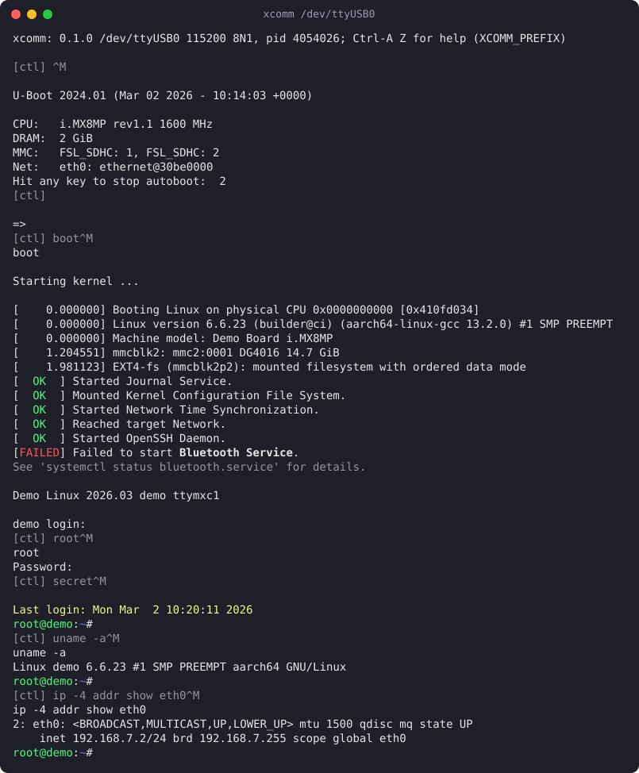
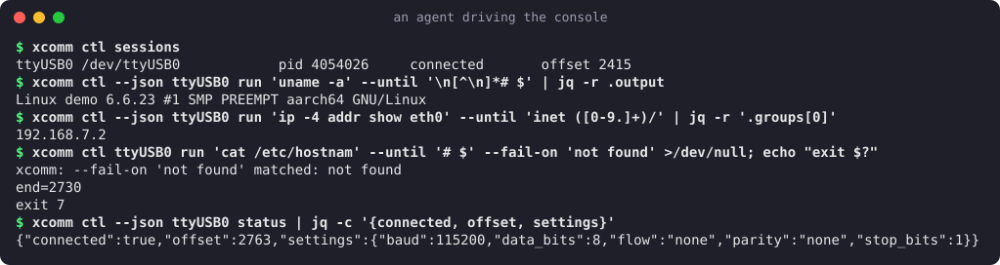
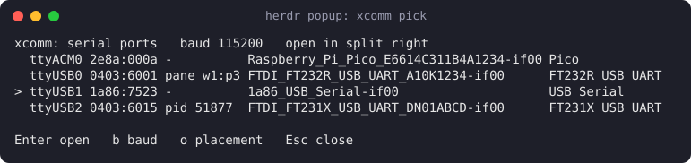
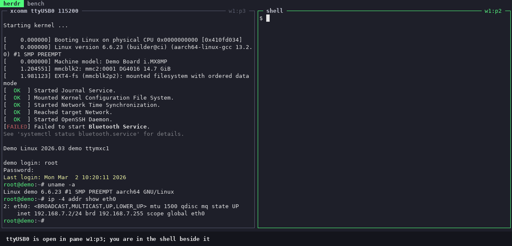
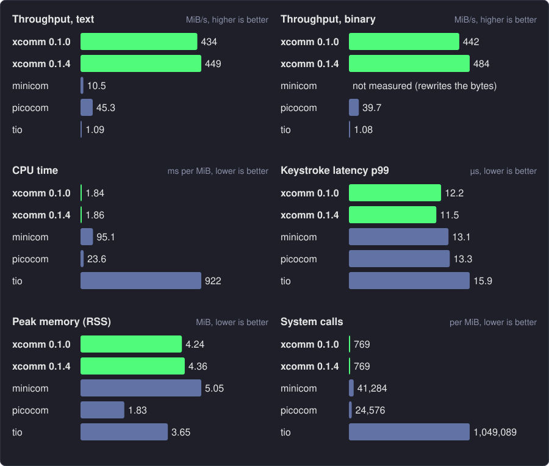

<h1 align="center">xcomm</h1>

<p align="center"><b>A serial terminal. Built for speed. Made for engineers. Ready for AI agents.</b></p>

<p align="center">
<a href="https://github.com/cantona/xcomm/actions/workflows/ci.yml"></a>
<a href="https://crates.io/crates/xcomm"></a>
<a href="#license"></a>
</p>

<p align="center">
<a href="#benchmarks">40× minicom's throughput on a fiftieth of its CPU</a>.
The keys your fingers already know. A control socket that lets scripts and
coding agents drive the board while you watch. A
<a href="https://github.com/herdrdev/herdr">herdr</a> plugin that puts every
console one keystroke away.
</p>

<p align="center"></p>

> The pictures in this README, and its `xcomm list` output, are of a simulated
> board (`scripts/demo-board.py`) and made-up USB adapters, captured from a real
> xcomm.

## Why xcomm

- **Hand the console to an agent.** Every running session has a control
  socket (unless you turn it off). From another shell, a test or an AI coding
  agent, `xcomm ctl` sends commands, waits for prompts with regexes, reads
  output by offset, flips DTR/RTS, sends breaks, changes the baud and runs
  zmodem transfers, while you watch the same console live.
- **Built for speed.** 40× minicom's throughput on a fiftieth of its CPU:
  434 MiB/s through a pty on 1.84 ms of CPU per MiB, where minicom does
  10.5 MiB/s on 95 ms. One `poll(2)` loop, a fixed 64 KiB buffer, no
  allocation once running, device bytes written straight to the terminal; on
  a real serial line that is CPU left for everything else. Its median
  keystroke latency is the lowest of the four tools measured, within a
  microsecond of minicom's. [Benchmarks](#benchmarks)
- **Agent-ready out of the box.** `xcomm --skill` prints a ready-made skill
  that teaches a coding agent to stop U-Boot, log in, run commands and parse
  the results. A test runs every example in it against a real session, so it
  never drifts from the binary.
- **Survives the bench.** Unplug the adapter, power-cycle the board: the
  session waits and reopens the port when it comes back, on Linux by the USB
  port it is plugged into (or the link you named it by).
- **Plug in a board, get a pane.** The herdr plugin tells you when an adapter
  is plugged in or pulled, and its port picker popup opens each port in a pane
  of its own, titled with its port and baud. Break, DTR, RTS, capture, baud
  and file transfers are actions on the focused pane.
- **Familiar.** minicom's options and its `Ctrl-A` keys. Inside a terminal
  multiplexer the prefix becomes `Alt-A`, so it never fights tmux, screen,
  zellij or herdr.
- **One binary, any terminal.** Linux or macOS, alone or inside tmux, screen
  or zellij. The control socket and the agent skill work the same without
  herdr; the plugin is an extra, not a requirement.

## Contents

- [Install](#install) · [Quick start](#quick-start) · [Features](#features)
- [Options](#options) · [Keys](#keys) · [Control socket](#control-socket)
  · [Exit codes](#exit-codes)
- [Agent skill](#agent-skill) · [herdr plugin](#herdr-plugin)
- [Uninstall](#uninstall) · [Benchmarks](#benchmarks) · [Platforms](#platforms)
  · [Clean room](#clean-room) · [License](#license)

## Install

**With Homebrew** (macOS, Linux; man page included):

```sh
brew install cantona/tap/xcomm
xcomm skill install        # the agent skill, if you use one
```

**With cargo** (from [crates.io](https://crates.io/crates/xcomm)):

```sh
cargo install --locked xcomm
xcomm skill install        # the agent skill, if you use one
```

For what is on master but not released yet:
`cargo install --locked --git https://github.com/cantona/xcomm xcomm`.
cargo installs no man page: `xcomm man` shows the one built in.

**As a herdr plugin** (builds and installs the binaries, the man page and the
agent skill):

```sh
herdr plugin install cantona/xcomm
```

**From a checkout**, linked into herdr:

```sh
git clone https://github.com/cantona/xcomm && cd xcomm
sh scripts/install.sh      # build, install to ~/.local (and man xcomm), link the plugin
```

Building needs Rust 1.93 or later, as in Ubuntu 26.04 (the Homebrew formula
uses its own; the herdr plugin and cargo use yours). File transfers
need [lrzsz](https://ohse.de/uwe/software/lrzsz.html) (`sz`/`rz`;
`brew install lrzsz` or `apt install lrzsz`); the herdr plugin needs herdr
0.9.5 or later.

## Quick start

```sh
xcomm ttyUSB0                         # 115200 8N1, Ctrl-A z for help
xcomm -b 921600 /dev/serial/by-id/usb-FTDI_...
xcomm list                            # what is plugged in, and who has it
```

From another shell, or an agent:

```sh
xcomm ctl ttyUSB0 run 'uname -a' --until '# $'
xcomm ctl ttyUSB0 wait 'login:' --timeout 120
xcomm ctl --json ttyUSB0 status
```

<p align="center"></p>

## Features

**Terminal**
- Any baud rate the driver accepts, not only the standard ones; data bits,
  parity, stop bits; RTS/CTS or XON/XOFF flow control.
- Colour passed through, removed when piped, or forced (`--color`), with a
  filter that drops only colour parameters and keeps bold and the rest.
- Line wrap, local echo, a break, DTR and RTS control, a hang-up pulse.
- `minicom`-compatible UUCP locks on Linux, plus an exclusive open
  everywhere, so two programs never share a port by accident; `xcomm list`
  shows who holds each one. (Stock macOS has no shared lock directory: there
  the locks keep xcomm sessions apart, and the exclusive open the rest.)
- `-o` to leave DTR and RTS as they are; FTDI 1 ms latency timer on Linux.

**Reliability**
- Survives an unplug: waits, and reopens the port by the link you gave it,
  or on Linux by the USB port it is plugged into (`/dev/serial/by-path`);
  otherwise by the name you gave. Not by by-id: identical adapters share one
  by-id name.
- A revoked or vanished device ends the session cleanly, never a spin.
- The terminal is restored after a quit, a termination signal or a
  job-control stop and resume.

**Capture and transfer**
- Capture to a file (`-C`, or `Ctrl-A l`), batched and flushed when idle.
- zmodem, ymodem and xmodem through lrzsz, with received files confined to the
  directory you chose (Landlock on Linux, sandbox-exec on macOS).

**Control socket** ([details](#control-socket))
- One socket per session, for the same user only; `rw`, `ro` or `off`.
- `send`, `read`, `wait` and `run` with regexes, `--fail-on`, `--idle`,
  absolute byte offsets, so a wait from an offset sees everything after it,
  and `--json` replies.
- `break`, `dtr`/`rts` (with pulses), `set` for line settings, `capture`,
  and file transfers, each ordered against the bytes queued before it.
- A 1 MiB ring of device output (`--ring-size`) to look back through.
- `--headless` sessions for CI and agents, with no terminal at all.
- What a client sends shows in your terminal as a `[ctl]` line (dim, unless `--color never` or `NO_COLOR`).

**For agents**
- `xcomm --skill` and `xcomm skill install`: a skill for Claude Code and
  other agents, tested against the real binary.

**herdr**
- Picker popup, session panes with port and baud in the title, eleven
  actions, a hotplug watcher with notifications.

**Install hygiene**
- `xcomm uninstall` removes everything an install made, in order;
  `xcomm doctor` reports what is installed and what is left over.

```text
$ xcomm list
TTY      VID:PID    PRODUCT          LOCK             HERDR       BY-ID
ttyACM0  2e8a:000a  Pico             free             -           /dev/serial/by-id/usb-Raspberry_Pi_Pico_E6614C311B4A1234-if00
ttyUSB0  0403:6001  FT232R USB UART  locked by 48213  pane w1:p3  /dev/serial/by-id/usb-FTDI_FT232R_USB_UART_A10K1234-if00-port0
ttyUSB1  1a86:7523  USB Serial       free             -           /dev/serial/by-id/usb-1a86_USB_Serial-if00-port0
ttyUSB2  0403:6015  FT231X USB UART  locked by 51877  -           /dev/serial/by-id/usb-FTDI_FT231X_USB_UART_DN01ABCD-if00-port0
```

## Options

| Option | Meaning |
|---|---|
| `-b <baud>` | baud rate (default 115200) |
| `--databits 5\|6\|7\|8` | data bits (default 8) |
| `--parity none\|even\|odd` | parity (default none) |
| `--stopbits 1\|2` | stop bits (default 1) |
| `--flow none\|rts\|xon` | flow control: RTS/CTS or XON/XOFF (default none) |
| `-o` | leave DTR and RTS alone |
| `--no-lock` | take no UUCP lock file (the port is still opened exclusively); `XCOMM_NO_LOCK=1` does the same where no option can be given, as in the herdr plugin |
| `--low-latency` | FTDI adapters on Linux: 1 ms latency timer |
| `--color auto\|always\|never` | colours in device output, and the dim of the `[ctl]` line (`-c on\|off` is the same); `NO_COLOR` takes the dim off, not the device's colours |
| `-w` | turn line wrap on |
| `-C <file>` | append device output to `<file>` |
| `--ring-size <bytes>` | device output kept for the control socket (4k to 1g, default 1m) |
| `--ctl rw\|ro\|off` | what the session's socket allows (default rw) |
| `--headless` | no terminal: output only to the socket's clients and `-C` |
| `--no-ctl-marker` | do not show what clients send as a `[ctl]` line |
| `--prefix <key>` | the command prefix: `ctrl-<letter>` (not h, i, j or m) or `alt-<letter>` (also `-e`, `--escape`) |
| `-m`, `--metakey` | the same as `--prefix alt-a` |
| `--prefix-time <ms>` | how long a key cut short waits for its rest (1 to 1000, default 25) |
| `--show-prefix` | print the prefix a session would use, and why |
| `-D <device>` | the device, as an option |
| `-h`, `--help` / `-V`, `--version` | help, version |

`xcomm --help` and `xcomm man` have the full text.

## Keys

The prefix is the first of: `--prefix`; `XCOMM_PREFIX`; `Alt-A` inside herdr,
the Herdr app, tmux, screen or zellij; otherwise `Ctrl-A`, as in minicom. The
banner says which, and why.

| After the prefix | |
|---|---|
| `z` | help |
| `x`, `q` | quit |
| `f` | send a break |
| `h` | hang up (drop DTR for 500 ms) |
| `d`, `t` | toggle DTR, toggle RTS |
| `p` | change the baud rate |
| `e` | toggle local echo |
| `w` | toggle line wrap |
| `l` | start or stop capture |
| `s`, `r` | send, receive files (zmodem, ymodem, xmodem) |
| the prefix again | send the prefix key itself |
| `Esc` | cancel |

Alt works as Esc-plus-letter and in the kitty keyboard protocol's CSI-u form.

**Over ssh or sudo:** multiplexer variables do not cross `ssh` and `sudo`
removes them, so on a remote host inside tmux the automatic rule picks
`Ctrl-A`. Put `XCOMM_PREFIX=alt-a` in the remote profile.

## Control socket

Every session (unless started with `--ctl off`) listens on
`$XDG_RUNTIME_DIR/xcomm/<tty>.sock` (or `/tmp/xcomm-<uid>/`), reachable only
by your user.

| Command | |
|---|---|
| `xcomm ctl <dev> status [<field>]` | port, settings, modem lines, offsets; one field's value alone (`offset`, `pid`, …) |
| `xcomm ctl <dev> send <text>` | send text and Enter; `-n`, `--lf`, `--crlf`; `--hex`, `--file` for raw bytes |
| `xcomm ctl <dev> read` | output kept: `--since <offset>`, `--last <bytes>`, `--max-bytes`, `--from-oldest`; next offset on stderr |
| `xcomm ctl <dev> wait <regex>` | wait for a match: `--since`, `--timeout <s>`, `--fail-on <regex>`, `--idle <ms>`, `--raw`, `--unicode` |
| `xcomm ctl <dev> run <text> --until <regex>` | send, then wait from the send; prints the output in between (`--max-bytes`, default 16 MiB) |
| `xcomm ctl <dev> break [ms]` | a break (default 250 ms) |
| `xcomm ctl <dev> dtr\|rts on\|off\|toggle\|pulse [ms]` | a modem line |
| `xcomm ctl <dev> set baud=… databits=… parity=… stopbits=… flow=…` | change line settings |
| `xcomm ctl <dev> capture start <file>` / `capture stop` | capture on the session |
| `xcomm ctl <dev> xfer send\|recv zmodem\|ymodem\|xmodem [<file>…]` | run lrzsz on the session's port |
| `xcomm ctl sessions` | the running sessions |
| `xcomm ctl --pane <id> …` | the session in a herdr pane, not by device |
| `--json` | the reply as JSON |
| `-q`, `--quiet` | `read`, `wait`, `run`: no `next=`/`end=` line on stderr (for `\| tee` and the like) |

A `wait` match spans at most 64 KiB, and escape sequences are removed before
matching unless `--raw`. `\w`, `\d`, `\s` and `(?i)` are ASCII; `--unicode`
makes them Unicode-aware in a build with `--features unicode`.

## Exit codes

`xcomm ctl` exits with:

| Code | Meaning |
|---|---|
| 0 | ok |
| 1 | `wait`/`run` timed out, or another error |
| 2 | usage error (or `run` output over `--max-bytes`) |
| 3 | no session for the device |
| 4 | port disconnected |
| 5 | busy (a file transfer) |
| 6 | offset evicted from the ring |
| 7 | a `--fail-on` pattern matched |
| 8 | permission denied (`--ctl ro`, or not your socket) |
| 9 | subscriber dropped (fell behind) |

A session exits 0 after quit, end of input or a termination signal, 1 on an
error or when the device goes away, 2 on a usage error or a port in use.

## Agent skill

```sh
xcomm --skill                       # print it
xcomm skill install                 # ~/.agents/skills/xcomm/SKILL.md
xcomm skill install --dir <dir>     # anywhere else
```

The skill tells an agent when to use xcomm and when not, how to start a
session and stop only its own, the rules (always a timeout, `--fail-on` for
failures, ask before a break or a baud change on someone else's session),
recipes, the exit codes and what to do about each, and worked examples:
stopping U-Boot's autoboot, logging in, parsing `--json`, capturing a boot log
and a zmodem upload. `xcomm skill install` refuses a directory a dotfiles
repository may own unless you give `--dir`, and replaces only a copy it wrote.

## herdr plugin

<p align="center"></p>

Open a port and the picker finds the pane it is already in, or makes one:

<p align="center"></p>

> The picker and both sessions are xcomm's own output: made-up ports, and
> boards simulated on ptys whose paths and pids are written as the made-up
> ports' (`scripts/picker-gif-capture.sh`). The herdr window around them is
> drawn for the picture (`scripts/picker-gif.py`).

Enter on a port does one of three things:

| The port's row | Enter |
|---|---|
| `pane w1:p3` (ttyUSB0): open in an xcomm pane | jumps to that pane; no second session |
| `-` (ttyACM0, ttyUSB1): free | opens it in a new pane, titled with its port and baud |
| `pid 51877` (ttyUSB2): held by another program, such as minicom, or by an xcomm session outside herdr (or one not answering) | opens nothing and says "ttyUSB2 is in use by process 51877" |

What each action does when you press its key (the keys are the ones bound
below; pane actions act on the xcomm session in the focused pane):

| Key | Action (id) | What you see |
|---|---|---|
| `prefix+shift+s` | open serial port (`open`) | the picker popup above: arrows choose a port, Enter goes to its pane or opens one, `b` sets the baud, `o` the placement, Esc closes |
| `prefix+shift+b` | send break (`break`) | a notification, *xcomm: break*, "break sent" |
| `prefix+shift+u` | change baud (`baud`) | a prompt popup (below); Enter applies it and the pane title follows |
| `prefix+shift+c` | toggle capture (`capture`) | with no capture running, a prompt for the file, then the device output is saved to it; with one running, it stops: *xcomm: capture stopped*, "/home/you/boot.log (48213 bytes)" |
| | toggle DTR / RTS (`dtr`, `rts`) | a notification with the new state: "DTR off", "RTS on" |
| | send file (`send-file`) | a prompt for paths, then the ZMODEM transfer runs in the popup ("Ctrl-C aborts it") |
| | receive file (`recv-file`) | a prompt for the directory (empty is your home), then the transfer runs in the popup |
| | hotplug watcher (`watch-start`, `watch-stop`, `watch-status`) | a notification, *xcomm: hotplug watcher*: "started (pid 4242)" (or "already running (pid 4242)", as herdr starts it), "stopped (pid 4242)", or "running (pid 4242)" / "not running" with the paths of its config and log and its last 5 log lines |

The prompt popup, here for `baud`:

```text
baud rate (Esc cancels)
digits, as 115200
> 921600
```

A wrong answer is shown in place of the hint and the prompt stays open. If the
request fails, the popup shows why and waits for Enter. A pane action pressed
in a pane that is not an xcomm session opens nothing and shows the error as a
notification: *xcomm: baud*, "xcomm: no xcomm session in pane w1:p2". `baud`,
`capture`, `send-file` and `recv-file` likewise refuse a session whose control
socket is read-only (`--ctl ro`) before asking anything.

While the watcher runs, a port plugged in or pulled gives a notification,
*Serial added* or *Serial removed*, with the adapter's name and tty, unless
`notify = false` or the port is in `ignore` (below).

Bind the actions to keys in herdr's `config.toml` (the id is the plugin's,
`cantona.herdr-xcomm`, then the action's: `open`, `break`, `dtr`, `rts`,
`capture`, `baud`, `send-file`, `recv-file`, `watch-start`, `watch-stop`,
`watch-status`), then `herdr server reload-config`:

```toml
[[keys.command]]
key = "prefix+shift+s"
type = "plugin_action"
command = "cantona.herdr-xcomm.open"
description = "xcomm: open serial port"

[[keys.command]]
key = "prefix+shift+b"
type = "plugin_action"
command = "cantona.herdr-xcomm.break"
description = "xcomm: send break"

[[keys.command]]
key = "prefix+shift+u"
type = "plugin_action"
command = "cantona.herdr-xcomm.baud"
description = "xcomm: change baud"

[[keys.command]]
key = "prefix+shift+c"
type = "plugin_action"
command = "cantona.herdr-xcomm.capture"
description = "xcomm: toggle capture"
```

Pick keys your keymap leaves free (`prefix+?` lists the ones taken): a
binding on one of herdr's default keys takes it over without a word, and the
built-in action is left with no key. `open` and the `watch-` actions also run from a
shell, as in `herdr plugin action invoke --plugin cantona.herdr-xcomm open`;
the others act on the focused pane, so they need a key pressed in the xcomm
pane.

The watcher (`xcomm watch start`, or `--daemon`) reads `notify = true|false` and
`ignore = ["0403:6001", "usb-FTDI_*"]` from the plugin's `config.toml`. It is
started with herdr and ends with it.

## Uninstall

```sh
xcomm uninstall
```

It stops the hotplug watchers, removes the skill (only a copy xcomm wrote),
unregisters the herdr plugin, then runs `cargo uninstall` (and removes the man
page from `~/.local/share/man`, only a copy xcomm wrote), printing each step,
and stops at the first failure saying what is left. Use it rather than
`herdr plugin uninstall`, which has no uninstall hook and leaves the binaries
and the skill behind. `xcomm doctor` reports anything left over.

Installed with Homebrew: run `xcomm uninstall` for the watchers and the skill
(it then names the binary as Homebrew's and the `brew uninstall xcomm` that
removes it), then run that command.

## Benchmarks

<p align="center"></p>

| | xcomm 0.1.0 | minicom 2.10 | picocom 3.1 | tio 3.9 |
|---|---|---|---|---|
| Throughput, text | **434 MiB/s** | 10.5 MiB/s | 45.3 MiB/s | 1.09 MiB/s |
| Throughput, binary | **442 MiB/s** | not measured¹ | 39.7 MiB/s | 1.08 MiB/s |
| CPU time per MiB | **1.84 ms** | 95.1 ms | 23.6 ms | 922 ms |
| System calls per MiB | **769** | 41,284 | 24,576 | 1,049,089 |
| Keystroke latency p50² | **8.60 µs** (8.51–9.34) | 8.79 µs (8.61–9.39) | 9.09 µs (8.98–10.35) | 11.57 µs (10.69–11.90) |
| Keystroke latency p99² | **12.16 µs** (11.79–13.62) | 13.13 µs (11.66–13.58) | 13.30 µs (12.45–14.15) | 15.93 µs (15.08–17.56) |
| Peak memory (RSS) | 4.24 MiB | 5.05 MiB | **1.83 MiB** | 3.65 MiB |

Every tool runs on the same pseudo-terminal pair with the same input, at
115200 8N1, with no configuration file, through the harness in `bench/`:

| Tool | Command line |
|---|---|
| xcomm | `xcomm --no-lock -b 115200 <pty>` |
| minicom | `minicom -o -D <pty> -b 115200` |
| picocom | `picocom -q --noreset -b 115200 <pty>` |
| tio | `tio -b 115200 -n --mute <pty>` |

- **Throughput, CPU, system calls, memory:** the median of 9 runs moving
  256 MiB of text and 256 MiB of random binary from the device to the terminal
  (`xcomm-bench run --size-mib 256 --runs 9 --strace`).
- ¹ minicom emulates a terminal and rewrites what it receives, so its output
  cannot be counted byte for byte; it is measured on text only.
- ² **Latency:** the time from a keystroke written to the terminal to its
  arrival at the device. Each round runs every tool in turn, 3 runs of 20,000
  keystrokes each (`--size-mib 4 --runs 3 --samples 20000`), and takes the
  median of the 3; the table gives the median of 5 rounds, with the lowest and
  highest round in brackets. xcomm's median is the lowest at p50 and p99, but
  the rounds overlap: minicom was ahead of xcomm in 2 rounds at p50 and 3 at
  p99, and picocom in 1 at p50, each by less than 1 µs. Read it as xcomm and
  minicom level, ahead of picocom and tio.
- **Memory:** xcomm keeps the last 1 MiB of output for the control socket
  (`--ring-size`), and its own code is larger; picocom keeps no output. About
  40% of xcomm's RSS (and most of picocom's) is the shared C library.
- tio writes each byte with a system call of its own, which is where its CPU
  time goes.

Measured on an Intel Core i7-10700 (16 threads), Linux 7.0, Ubuntu 26.04,
rustc 1.98.1, release build. To reproduce:

```sh
cargo build --release -p xcomm && cargo build --release -p xcomm-bench
# throughput, CPU, system calls, memory (per tool: xcomm, minicom, picocom, tio)
target/release/xcomm-bench run --tool target/release/xcomm --kind xcomm --size-mib 256 --runs 9 --strace
# one latency round (per tool); five rounds, the tools in turn
target/release/xcomm-bench run --tool target/release/xcomm --kind xcomm --size-mib 4 --runs 3 --samples 20000
```

For another tool give `--tool "$(command -v minicom)" --kind minicom`, and so
on. The harness needs Linux and strace. `scripts/perf-gate.sh <base>` runs it
on the working tree against a base revision; changes to the data path were
gated with it.

## Platforms

Linux and macOS. Windows is not supported.

## Clean room

xcomm is not derived from minicom. Its behaviour was specified from the
minicom man page and observed CLI and key behaviour only; minicom's source was
never read or translated while writing it.

## License

Copyright 2026 Su Kang Yin. Licensed under the
[GNU General Public License, version 2 only](COPYING).
